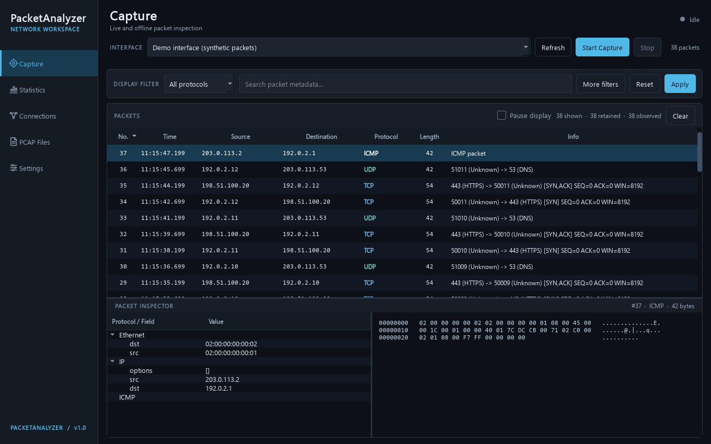
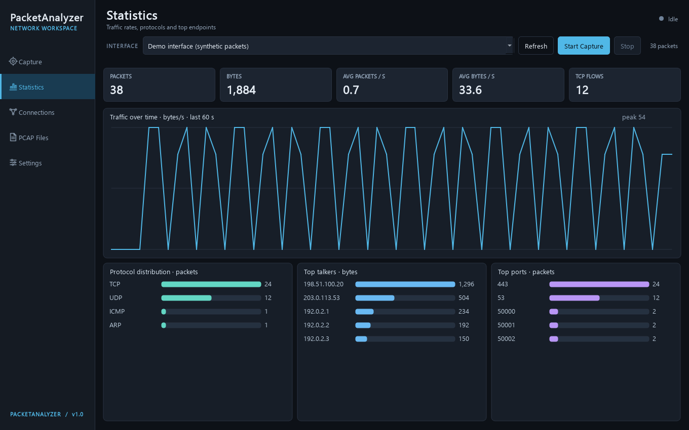

# PacketAnalyzer

A Windows desktop packet analyzer built with Python, Scapy and PySide6. Inspect live traffic or open a PCAP, filter packet metadata, review protocol layers and hex bytes, and export retained packets or CSV metadata. The original command-line interface remains available.



_Actual application window rendered with synthetic documentation IP addresses. No private capture data is included. Recreate it with `python screenshots/generate_demo.py`._



## Features

- Live capture from dynamically discovered interfaces, with start/stop controls and a responsive GUI.
- Sortable, protocol-colored packet table; TCP, UDP, ICMP, ICMPv6, ARP, IPv4 and IPv6 parsing.
- Display filters for protocol, source/destination/either IP, source/destination/either port, and metadata text. These are **display filters**, not BPF or Wireshark syntax.
- Packet inspector with a protocol tree and offset/hex/ASCII bytes.
- Sidebar navigation, keyboard shortcuts, packet context menu, and saved inspector split sizes.
- Background PCAP loading; export all currently retained packets to PCAP or displayed packet metadata to CSV.
- Packet and byte counts, timeline, protocol and top-talker charts, and observed TCP flows.
- Configurable GUI memory limit, pause display, auto scroll, and saved interface/limit/directory preferences.
- Separate CLI for PCAP reading and live capture.

## Technology stack

Python 3.11, Scapy 2.7.0, PySide6, pytest, GitHub Actions. The charts use Qt painting and need no extra plotting package.

## Requirements

- Windows 10/11 and Python 3.11.
- [Npcap](https://npcap.com/) for **live capture**. Install it separately; the app does not bundle its driver. Follow the [Scapy Windows installation guidance](https://scapy.readthedocs.io/en/latest/installation.html#windows). If capture access is restricted by your Npcap installation, run with the required Windows permissions.
- Opening existing PCAPs and running synthetic tests do not require Npcap or administrator access.

Capture only traffic you own or are authorized to inspect. PCAP files and packet hex can contain private data. The app does not automatically upload traffic or write capture files; saving requires an explicit action. Keep private captures out of Git.

## Installation

```powershell
cd D:\Projects\PacketAnalyzer
py -3.11 -m venv .venv
.\.venv\Scripts\Activate.ps1
python -m pip install -r requirements.txt
```

If an existing `.venv` is already present, activate it and install the requirements. Install Npcap from its official site before attempting live capture.

## Quick start

```powershell
python -m app.gui
```

Choose an interface and select **Start Capture**. **Stop Capture** requests a safe stop; the worker exits after its current short sniff interval. **Pause display** freezes the table while capture and statistics continue. If its bounded pending buffer fills, older pending rows are discarded. Use **Clear** to reset the current view and statistics.

## CLI usage

```powershell
python -m app.main --help
python -m app.main --interface 11 --protocol tcp --port 443 --stats --connections
python -m app.main --save captures\my-session.pcap --stats
python -m app.main --read captures\my-session.pcap --protocol udp --stats
```

Interface `11` is only an example; omit `--interface` to use Scapy's current default or pass a name/index for your machine. Stop live CLI capture with Ctrl+C. `--save` streams the captured packets to the named file only when requested.

## PCAP analysis and exports

**Open PCAP** loads a `.pcap` in the background. The table keeps the most recent packets up to its configured limit; session statistics count every packet processed. A damaged file reports an error. **Save PCAP** writes all retained packets, ignoring the display filter. **Export CSV** writes only currently displayed rows and contains timestamp, endpoints, protocol, length, ports and summary info; it does not include payload bytes. PCAPNG is not advertised as a supported input format.

## Architecture

- `app/capture.py`: Scapy interface discovery and stoppable capture worker.
- `app/parser.py`, `filters.py`, `connections.py`, `statistics.py`, `pcap.py`: GUI-independent analysis.
- `app/gui/`: Qt main window, table model, filters and charts. Capture and PCAP workers put results into a bounded queue; a Qt timer updates widgets on the GUI thread.
- `app/main.py`: existing CLI entry point.

## Testing

```powershell
python -m pip install pytest
python -m pytest -q
```

Tests use synthetic packets and a temporary PCAP. They do not perform a live capture. GitHub Actions runs them on Windows with Python 3.11.

## Known limitations

- Live Windows capture and Npcap permissions still require a manual check on a real adapter. Automated tests and a GUI launch alone do not verify live capture.
- The GUI retains at most the configured number of visible packets, plus a bounded pending display buffer while paused. The input queue is also bounded; under sustained overload, packets dropped from the GUI queue are counted in the status line.
- TCP flows are grouped by endpoints and show observed flags. A complete TCP state cannot be inferred from an incomplete capture.
- Statistics describe all packets processed in this session, while PCAP export describes only currently retained packets. Traffic rates shown in Statistics are averages across the observed timestamp interval.
- CSV exports metadata from the current display filter. Hex and payload bytes remain available only in the interactive packet detail view and PCAP export.
- Saving a huge PCAP runs in a worker, but available memory still depends on packet size and the configured retention limit.

## Roadmap

- Validate and document real Npcap capture on multiple Windows adapters.
- Add a Windows executable build after a clean packaging and driver check.
- Expand performance testing with large synthetic PCAPs and add capture-side BPF filters if needed.
